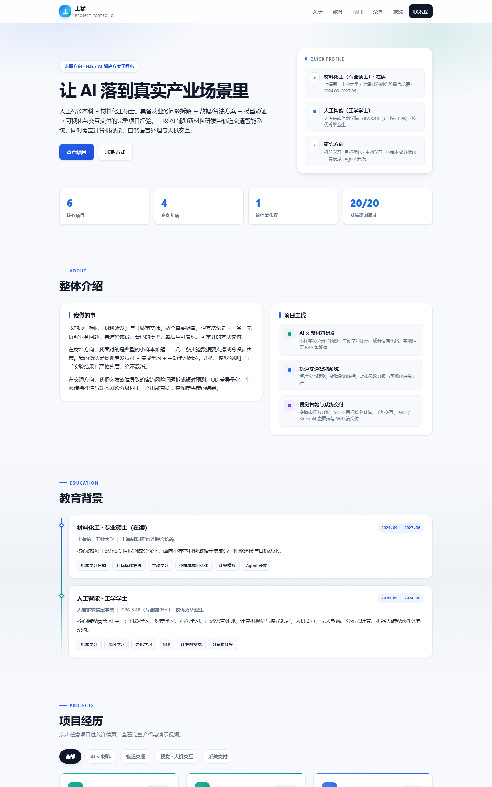
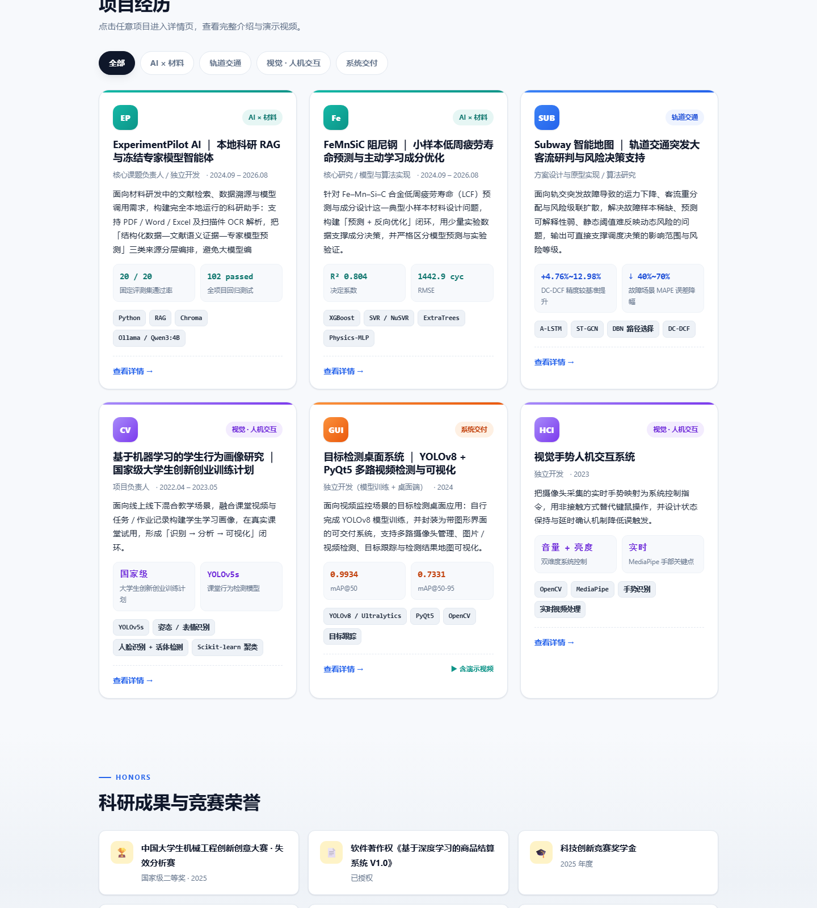
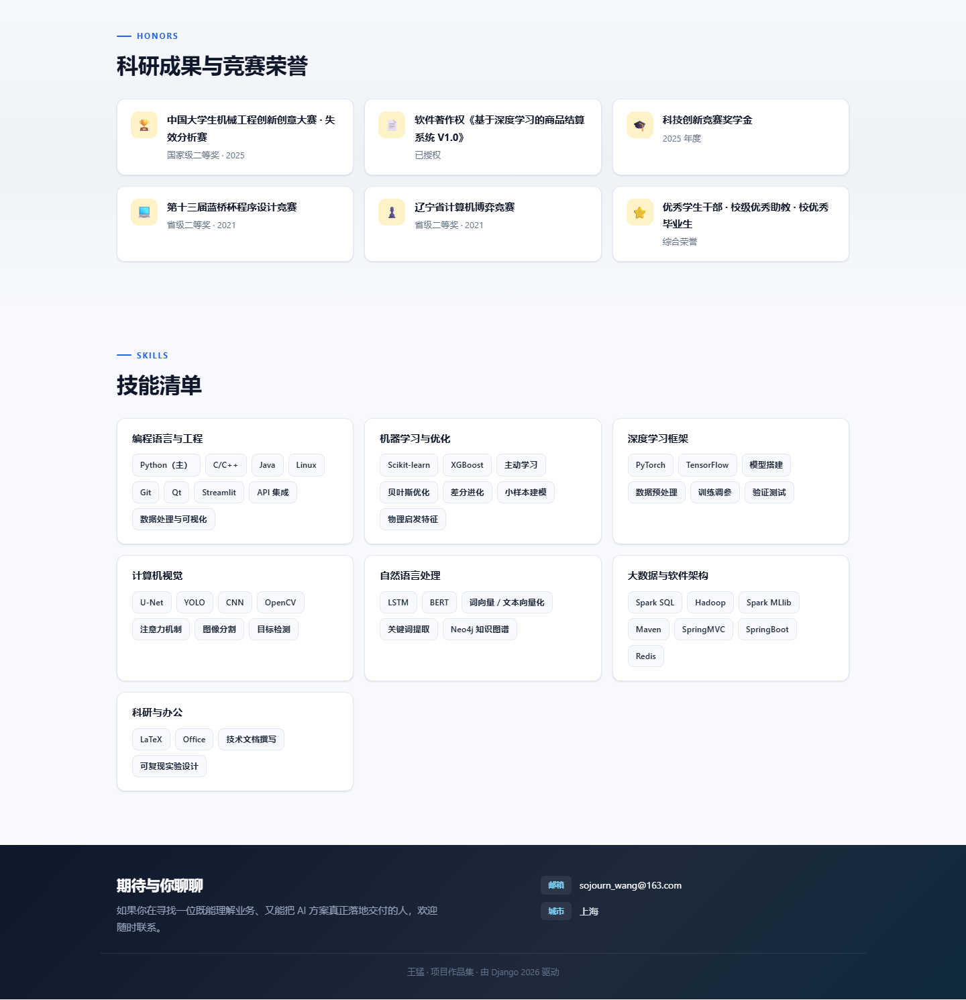
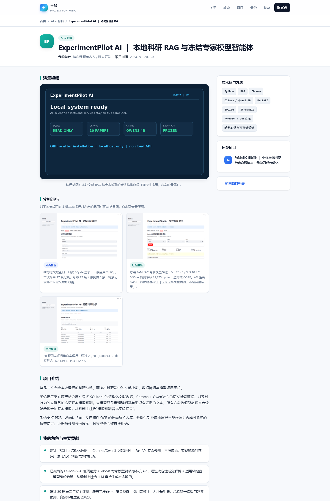
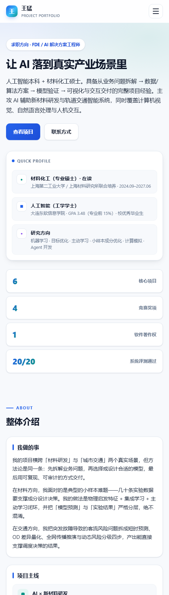
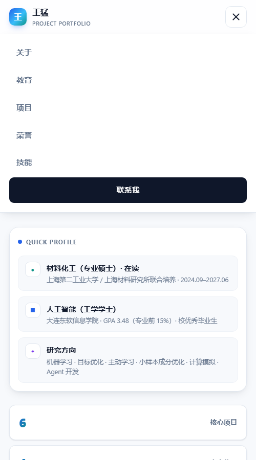

<div align="center">

# 项目作品集 · Project Portfolio

**一个用 Django 构建的个人项目作品集网站**

从业务问题拆解 → 数据 / 算法方案 → 模型验证 → 可视化与交互交付

<sub>AI × 新材料研发 ｜ 轨道交通智能系统 ｜ 视觉智能与系统交付</sub>

---

### ▶ [**点这里直接看在线站点**](https://7ab156b731314b5599d7ff21a3c6f183.sg.agentos-app.run)

<sub>分类筛选、详情页的前后项目翻页、演示视频都能真点 —— 不是静态快照，是真的 Django 在跑</sub>

---

</div>

> **这个仓库和上面那个链接是什么关系？**
> 仓库里是**源码**，GitHub 不会替你运行 Django。
> 想看到网站本身，请点上面的在线地址；想在本地跑，见「快速开始」。

---

## 项目截图

<p align="center">
  
</p>

<p align="center">
  
</p>

<p align="center">
  
</p>

<p align="center">
  
</p>

<p align="center">
  
  &nbsp;&nbsp;
  
</p>

---

## 功能特性

- **完整介绍页** — 首页一次性呈现个人定位、整体介绍、项目主线、教育背景、项目列表、
  荣誉与技能，导航锚点可直达各区块。
- **项目卡片封面** — 每张项目卡片顶部渲染一张封面图，取值优先级为
  「显式指定的封面图 → 第一张实机截图 → 演示动图」，三者皆无则不渲染封面；
  封面右下角带分类角标，悬停轻微放大。所有封面均取自项目真实运行产出，非设计稿。
- **项目详情页** — 每个项目独立页面，包含完整介绍、我的角色与主要贡献、量化指标、
  技术栈、相关链接，以及**可播放的演示视频**与**实机运行图集**。
- **实机运行图集** — 每个项目可挂多张真实运行产出的截图 / 结果图，带类型标签
  （界面截图 / 运行结果 / 图表曲线 / 桌面端界面）与逐张文字说明，
  响应式网格布局，点击缩略图查看原图；图表类缩略图保持完整不裁切。
- **演示素材自动降级** — 本地视频文件 → 外部嵌入链接 → GIF 动图 →
  无视频但有截图则不显示占位 → 完全无素材才提示补充，缺素材也不会破版。
- **分类筛选** — 项目按「AI × 材料 / 轨道交通 / 视觉 · 人机交互 / 系统交付」四类组织，
  支持 URL 参数筛选（`?category=materials`），可分享具体筛选结果。
- **数据全部后台可维护** — 项目、贡献点、指标、技术栈、链接、实机截图、首页各区块文案
  均在 Django Admin 中维护，无需改代码；项目下的五类明细用内联表格批量编辑。
- **响应式布局** — 桌面端 / 平板 / 移动端三档断点，移动端为汉堡菜单 + 单列布局。
- **社交分享卡片** — 每个页面都输出完整的 Open Graph / Twitter Card 元信息
  （`og:title` / `og:description` / `og:image` / `og:url` / canonical），
  把链接发到微信、飞书、LinkedIn、X 时会显示成带标题、摘要与配图的卡片，
  而不是一条光秃秃的链接。首页用 1200×630 的品牌分享大图
  （由 `docs/tools/make_og_cover.py` 生成），详情页自动改用该项目的封面图，
  并如实写入图片真实宽高。
- **可被搜索引擎收录** — 自带 `robots.txt`（屏蔽 `/admin/`）与
  `sitemap.xml`（首页 + 全部项目详情页，`lastmod` 取项目更新时间）。
- **零前端依赖** — 原生 HTML / CSS / JavaScript，无框架、无 CDN，**可完全离线运行**。
- **38 项自动化测试** — 覆盖首页各区块、分类筛选与非法参数回退、空态提示、
  6 个详情页渲染、视频嵌入、实机图集渲染与空态、卡片封面取值优先级、
  翻页与同类推荐、404（含自定义 404 页）、后台登录保护、
  分享卡片元信息与 `SITE_URL` 生效、`robots.txt` / `sitemap.xml`、
  以及「模板语法不得泄漏」与「截断必须带省略号」两条防回归断言。

---

## 技术栈

| 层次 | 选型 |
|---|---|
| 后端框架 | Django 3.2（LTS） |
| 语言 / 运行时 | Python 3.8+ |
| 数据库 | SQLite（开箱即用，可平滑换 PostgreSQL） |
| 模板 | Django Template Language |
| 前端 | 原生 HTML5 / CSS3（变量 + Grid + Flex）/ ES6，无任何第三方依赖 |
| 媒体服务 | Django `MEDIA_URL` / `MEDIA_ROOT` 静态媒体托管 |
| 部署 | Gunicorn（WSGI 服务器）+ WhiteNoise（自托管 `/static/`），见 `deploy/start.sh` |
| 图片处理 | Pillow（Django `ImageField` 的硬依赖，缺则 `migrate` 报 `fields.E210`） |
| 测试 | Django `TestCase` |

---

## 快速开始

```bash
# 1. 克隆
git clone <仓库地址>
cd project-portfolio

# 2. 创建虚拟环境（推荐）
python -m venv .venv
# Windows
.venv\Scripts\activate
# macOS / Linux
source .venv/bin/activate

# 3. 安装依赖
pip install -r requirements.txt

# 4. 建库
python manage.py migrate

# 5. 导入作品集数据（6 个项目 + 首页各区块 + 荣誉 + 技能）
python manage.py seed_projects

# 6. 启动
python manage.py runserver
```

打开 <http://127.0.0.1:8000/>

> **关于数据**：`db.sqlite3` 未纳入版本库。执行 `migrate` + `seed_projects` 后，
> 网站内容与演示素材即可完整复现。
> 如需重置数据：`python manage.py seed_projects --reset`

### 进入后台管理

```bash
python manage.py createsuperuser
```

登录 <http://127.0.0.1:8000/admin/> 即可维护全部内容。

---

## 项目结构

```text
project-portfolio/
├── manage.py
├── requirements.txt
├── config/                          # 项目配置
│   ├── settings.py                  # 模板 / 静态 / 媒体 / 中文 / 上传上限 / 生产安全项
│   ├── urls.py                      # 路由入口（含媒体文件服务）
│   ├── asgi.py
│   └── wsgi.py
├── deploy/
│   └── start.sh                     # 部署启动脚本（migrate → seed → collectstatic → gunicorn）
├── showcase/                        # 核心应用
│   ├── models.py                    # 数据模型
│   ├── views.py                     # home() 首页聚合 + detail() 详情页 + page_not_found()
│   ├── urls.py                      # 应用路由（app_name = showcase）
│   ├── admin.py                     # 后台管理（项目含 5 个内联表）
│   ├── context_processors.py        # site_url / og_image_url（分享卡片要绝对地址）
│   ├── sitemaps.py                  # sitemap.xml 收录规则
│   ├── media.py                     # 媒体文件视图（支持 Range，视频进度条能拖）
│   ├── tests.py                     # 63 项冒烟测试
│   ├── migrations/
│   ├── management/commands/
│   │   └── seed_projects.py         # 数据导入命令（支持 --reset）
│   ├── templatetags/
│   │   └── showcase_extras.py       # ellipsis 过滤器（中文下 truncatechars 不加省略号）
│   └── templates/
│       ├── 404.html                 # 自定义 404（DEBUG=False 时生效）
│       ├── robots.txt               # 纯文本模板
│       └── showcase/
│           ├── base.html            # 公共骨架（导航锚点 / 页脚联系 / 分享卡片元信息）
│           ├── home.html            # 首页
│           └── detail.html          # 详情页
├── static/
│   ├── favicon.svg                  # 站点图标（SVG，与页头 brand-mark 同款渐变）
│   ├── og-cover.png                 # 分享卡片大图（1200×630，由脚本生成）
│   ├── css/style.css                # 全部样式（含响应式断点）
│   └── js/main.js                   # 移动端菜单 / 滚动状态 / 回到顶部
├── media/
│   ├── videos/                      # 演示视频（mp4）
│   ├── shots/<slug>/                # 实机截图 / 结果图（每个项目一个目录）
│   ├── covers/                      # 列表卡片封面（手工指定时使用）
│   └── demos/                       # 视频海报帧 / 演示动图
└── docs/
    ├── screenshots/                 # 界面截图
    └── tools/
        ├── make_og_cover.py         # 分享大图生成脚本（资料改了重跑一次）
        ├── audit_page.js            # 单页体检（控制台报错 / 404 / 裂图 / 横向溢出）
        └── linkcheck.js             # 全站爬取（逐页状态码 + 标题）
```

---

## 路由

| 地址 | 视图 | 说明 |
|---|---|---|
| `/` | `showcase:home` | 首页，列出全部项目与各介绍区块 |
| `/?category=<key>` | `showcase:home` | 按分类筛选 |
| `/project/<slug>/` | `showcase:detail` | 项目详情页（演示视频 + 实机截图 + 翻页 + 同类推荐） |
| `/robots.txt` | `TemplateView` | 纯文本，屏蔽 `/admin/` 并声明 sitemap 地址 |
| `/sitemap.xml` | `django.contrib.sitemaps.views.sitemap` | 站点地图：首页 + 全部项目详情页 |
| 任意未匹配地址 | `showcase:page_not_found` | 自定义 404 页（仅在 `DJANGO_DEBUG=0` 时生效） |
| `/admin/` | Django Admin | 后台管理 |

分类键：`materials`（AI × 材料）、`transit`（轨道交通）、
`vision`（视觉 · 人机交互）、`delivery`（系统交付）。

---

## 首页区块与数据来源

| 区块 | 锚点 | 数据模型 |
|---|---|---|
| Hero 标语 / 简介 | — | `Profile.tagline` / `Profile.intro` |
| Quick Profile 资料卡 | — | `ProfileFact` |
| 统计数字条 | — | `Stat` |
| 整体介绍 | `#about` | `Profile.about`（空行分段） |
| 项目主线 | `#about` | `Pillar` |
| 教育背景 | `#education` | `Education` |
| 项目经历 | `#projects` | `Project`（+ 贡献 / 指标 / 技术栈 / 链接） |
| 荣誉奖项 | `#awards` | `Award` |
| 技能清单 | `#skills` | `SkillGroup` |
| 联系方式 | `#contact` | `Profile.phone` / `email` / `city` |

---

## 数据模型

```text
Profile (单例：Hero + 关于 + 联系方式)
Stat / ProfileFact / Pillar / Education          # 首页展示区块
Award / SkillGroup                               # 荣誉 / 技能

Project ──┬── Contribution (贡献点)
          ├── Metric       (量化指标)
          ├── TechItem     (技术栈)
          ├── ProjectLink  (相关链接)
          └── ProjectShot  (实机截图 / 结果图)
```

`Project` 的演示素材字段，详情页按优先级自动选择：

1. `video_file` → HTML5 `<video>` 播放器（本地文件）
2. `video_external_url` → `<iframe>` 嵌入（B站 / YouTube 等）
3. `demo_image` → GIF 动图
4. 都没有、且该项目也没有实机截图 → 「演示视频待补充」占位提示

「实机运行」图集来自 `ProjectShot`（`related_name='shots'`），
每张图带类型标签（界面截图 / 运行结果 / 图表曲线 / 桌面端界面）与文字说明，
按 `order` 排序，点击缩略图可查看原图。

**列表卡片封面**由 `Project.cover_image_url` 决定，优先级为：

1. `cover_image` → 手工指定的封面图（用于「第一张截图不适合当封面」的情况）
2. 第一张 `ProjectShot` → 自动取该项目的首张实机截图
3. `demo_image` → 演示动图 / 视频海报帧
4. 都没有 → 返回空串，模板不渲染封面区（不会出现破图）

`demo_image` 同时用作 `<video>` 的 `poster` 海报帧；
「卡片封面」与「视频海报」因此可以各取所需、互不将就——
本项目里目标检测与手势交互两个项目的卡片封面就是单独裁切指定的。

**当前素材情况（全部为项目在本机真实运行后采集）：**

| 项目 | 演示视频 | 卡片封面 | 实机截图 |
|---|---|---|---|
| ExperimentPilot AI | GIF 动图 | 首张截图（自动） | 3 张（结构化查询 / 专家模型预测 / 20 题评测） |
| FeMnSiC 阻尼钢 | — | 首张截图（自动） | 3 张（LOOCV 预测-实测 / 成分候选 / 模型对比） |
| Subway 智能地图 | — | 首张截图（自动） | 3 张（风险站点排名 / 客流热力图 / 故障站恢复） |
| 学生行为画像 | — | 首张截图（自动） | 4 张（聚类组件 / 学生子页面 / 课程追踪 / 课堂数据） |
| 目标检测桌面系统 | ✔ mp4 | ✔ 指定（检测输出帧） | 1 张（桌面端主界面） |
| 视觉手势人机交互 | ✔ mp4 | ✔ 指定（摄像头窗口） | — |

两个 mp4 项目另各有一张 `media/demos/*-poster.jpg` 作为视频海报帧，
均直接抽取自对应演示视频的真实输出帧，非另行摆拍。

**隐私口径：** 目标检测项目的演示视频、截图与封面图均已做脱敏处理——
人体区域做强模糊、类别名统一替换为通用标签（`person`）；
学生行为画像中的真实姓名已替换为编号（`学生001`…`学生113`）；
手势交互演示视频左侧的项目文件树（含学号 + 姓名）已做区域模糊。
原始素材不随仓库发布。

补充方式：视频放进 `media/videos/`，截图放进 `media/shots/<slug>/`，
封面放进 `media/covers/`，海报帧放进 `media/demos/`，
再运行 `python manage.py seed_projects --reset`（或直接在后台内联表格里逐条添加）。

---

## 社交分享卡片

<p align="center">
  
</p>

把链接发到微信 / 飞书 / LinkedIn / X 时，这些平台会去抓页面里的
Open Graph 标签来生成预览卡片。标签由 `showcase/context_processors.py`
提供绝对地址，`base.html` 统一输出：

| 标签 | 首页取值 | 详情页取值 |
|---|---|---|
| `og:type` | `website` | `article` |
| `og:title` | 姓名 · 项目作品集 | 项目名 · 姓名 |
| `og:description` | `Profile.tagline` | 项目简介 |
| `og:image` | `static/og-cover.png`（1200×630） | 该项目封面图的**真实尺寸** |
| `og:url` / `canonical` | `SITE_URL` + 路径 | 同左 |

两个容易踩的点，这里都处理了：

1. **必须是绝对地址。** `og:url` / `og:image` 放相对路径时平台抓不到图，
   卡片会退化成一条纯文字链接。部署在反向代理后面时，
   `request.build_absolute_uri()` 可能拿到内网地址或 `http`，
   所以**上线后务必显式配置 `DJANGO_SITE_URL`**（见「部署」一节）。
2. **尺寸要如实写。** `og:image:width` / `height` 是给平台的宽高比提示。
   详情页的 `og:image` 换成了项目封面，尺寸并不固定，
   因此这两个值取自 `ImageField.width/height` 的真实读数；
   读不到就干脆不输出，而不是沿用首页的 1200×630 蒙混过去。

首页分享大图由脚本生成（姓名、定位、统计数字都写死在图里）：

```bash
python docs/tools/make_og_cover.py     # 产出 static/og-cover.png
```

`seed_projects` 里的资料改了之后重跑一次即可。
测试 `test_og_cover_asset_is_1200x630` 会把「模板里写死的 1200×630」
和「真实素材尺寸」绑在一起，素材换了尺寸而模板没跟上时会先失败。

---

## 后台管理

登录 `/admin/` 后可：

- 维护项目基本信息、完整介绍、角色与时间；
- 通过**内联表格**直接编辑该项目的贡献点、量化指标、技术栈、相关链接，
  以及**实机截图 / 结果图**（可逐张设置类型、说明与排序，带缩略图预览）；
- 上传 / 替换**演示视频**、填**外部视频链接**、上传**演示动图**或**列表封面图**
  （封面留空即自动取首张实机截图、再退到演示动图）；
- 维护首页各区块：`Stat`（统计数字）、`ProfileFact`（资料卡）、
  `Pillar`（项目主线）、`Education`（教育经历，关键词用逗号分隔）；
- 维护个人资料（单例，含 `about` 正文）、荣誉奖项、技能分组。

---

## 测试

```bash
python manage.py test showcase -v 2
```

覆盖范围：seed 数据完整性、模型属性（分段 / 关键词拆分）、首页各锚点渲染、
分类筛选与非法分类回退、空态提示、卡片封面取值优先级与「6 张卡片均有封面」、
6 个详情页渲染、视频嵌入、实机图集渲染与「无截图时不渲染」、截图排序、
翻页与同类推荐、404 与自定义 404 页（`override_settings(DEBUG=False)`）、后台登录保护、
分享卡片元信息（绝对地址 / 默认图 / `SITE_URL` 生效 / 详情页真实封面尺寸）、
`robots.txt` 与 `sitemap.xml`、**媒体文件的 Range 行为**（23 项，见下）。

另有三条**防回归**断言，各自对应一个踩过的坑：

| 断言 | 防的是什么 |
|---|---|
| 渲染结果里不得出现 `{%`、`{{`、`{#` | Django 的 `{# #}` 注释**只支持单行**，写成多行会把注释原文输出到页面上 |
| 页面上的截断标题必须带 `…` | 中文（zh-hans / zh-hant）下 Django 内置 `truncatechars` 的省略号译成了**空串**，会静默截断 |
| `static/og-cover.png` 必须是 1200×630 | `base.html` 里写死了这个尺寸，素材换了而模板没改就会对不上 |

媒体 Range 的 23 项测试覆盖：完整请求的 `Accept-Ranges`、首段 / 中间段 / 单字节段 /
开放式段 / 后缀段、区间越界与倒置区间回 `416`、多段与畸形头降级为 `200`、
`If-Modified-Since` 回 `304`、`Content-Type` 不退化成 `application/octet-stream`、
`..` 穿越与软链越权被拒、开关关闭时 `404`、解析器边界用例，
以及一条用仓库里真实演示视频跑的端到端断言。

> **关于「夹具太小导致测试形同虚设」**：本组测试最初的夹具是 1024 字节，
> 而流式发送的块大小是 64 KiB —— 也就是说，哪怕生成器只 yield 第一块、
> 后面的全部漏掉，所有断言照样通过。补了一条用 130 KB 夹具（跨 3 个块）
> 的用例才真正覆盖到分块路径。
> **夹具尺寸必须跨过被测代码的阈值，否则测的是「没报错」，不是「对」。**

> **关于 `truncatechars`（值得单独记一笔）**：Django 3.2 的截断尾巴来自
> `pgettext('String to return when truncating text', '%(truncated_text)s…')`，
> 受当前语言影响 —— 英文下是 `'x…'`，zh-hans / zh-hant 下是 `'x'`。
> 于是中文站点的 `truncatechars` 会**静默截断**：标题被砍掉一半却没有任何提示，
> 读者根本看不出被截过。本项目改用自定义过滤器 `ellipsis`
> （`showcase/templatetags/showcase_extras.py`），显式传 `truncate='…'` 把尾巴钉死。

---

## 页面体检与全站核验（`docs/tools/`）

截图只能证明「看起来还行」。控制台报错、某个图标 404、某张图裂了、窄屏下横向溢出、
某个页面根本 404 —— 这些在截图里要么看不见，要么容易被忽略。
`docs/tools/` 下两个零依赖 Node 脚本（Node ≥ 21，用内置 `WebSocket` / `fetch`，
不需要 `npm install`）把它们量化成可读报告。

### `audit_page.js` —— 单页体检

```bash
# 桌面 / 平板 / 手机三个断点各跑一次
node docs/tools/audit_page.js --url https://<你的域名>/ --width 1440 --wait-for ".hero-copy"
node docs/tools/audit_page.js --url https://<你的域名>/ --width 768
node docs/tools/audit_page.js --url https://<你的域名>/ --width 375
```

共 10 项检查，分三类：

| 类别 | 检查项 |
|---|---|
| 运行期 | 控制台 `error` / `warning`、浏览器日志 `error`、未捕获异常 |
| 网络 | 请求失败（`Network.loadingFailed`）、HTTP ≥ 400 的响应 |
| DOM | `` 缺 `alt`、`` 裂图（`naturalWidth === 0`）、横向溢出（并定位越界元素）、无文本可点击元素缺 `aria-label` |

存在 error 级问题时退出码为 `1`，干净时为 `0`，可以直接接进 CI。
视口宽度用 `Emulation.setDeviceMetricsOverride` 设置，**绕开了 Windows
最小窗口宽度约 500px 的限制** —— 所以 375px 这种窄断点在它这里是可靠的。

### `linkcheck.js` —— 全站爬取

单页体检只能证明「我打开过的那一页没问题」。README 里写了「分类筛选、
前后项目翻页都能真点」这类话，那就得把每个可达页面都真的走一遍：

```bash
node docs/tools/linkcheck.js --root https://<你的域名>/ --max 80
```

它从根地址 BFS 爬同源 HTML 页面（跳过 `/static/` `/media/` 二进制资源 ——
那些由各页的子资源加载覆盖，`audit_page.js` 已在做），逐条报状态码与页面标题。

**本项目线上实测**：11 个页面全部 `200` —— 首页、4 个分类筛选页、6 个详情页。

### 工具自己也要被验证

一个「零缺陷」的报告，如果没验证过工具有抓取能力，**等于什么都没说**。
所以用一个**故意做坏**的页面做反向对照 —— 缺 `alt` 的图 + 指向 404 的图 +
2400px 宽的 `div` + 空 `button` + 一句 `console.error` —— 确认 6 类缺陷全部被抓到、
退出码为 `1`，这个脚本才算可信。

> 同一类错误也发生在 `linkcheck.js` 身上：它的链接正则最初写成
> `href\s*=\s*["']([^"'#]+)["']`，字符类里排除了 `#`。结果
> `href="?category=materials#projects"` **整条匹配失败**（闭合引号前是 `#`），
> 4 个分类筛选链接被静默丢掉，报告显示「共 7 个页面、全部 200」——
> 看起来一片绿，实际漏了三分之一。**正确的做法是先连片段一起捕获、再把片段丢掉。**

**本项目线上体检结果**（2026-10-16，`/` 与 `/project/gesture-hci/` 各跑 1440 / 768 / 375 三档）：

| 检查项 | 结果 |
|---|---|
| 控制台 error / warning | 0 / 0 |
| 浏览器日志 error | 0 |
| 请求失败 / HTTP ≥ 400 | 0 / 0 |
| 未捕获异常 | 0 |
| `` 缺 alt / 裂图 | 0 / 0 |
| 无标签可点击元素 | 0 |
| 横向溢出 | 0px |

---

## 响应式断点

| 断点 | 适配 |
|---|---|
| `> 980px` | 桌面端：Hero 双栏、详情页双栏（主内容 + 侧栏吸顶） |
| `≤ 980px` | 平板：Hero / 关于 / 详情页转单栏，统计条两列 |
| `≤ 720px` | 移动端：汉堡菜单、单列卡片、统计条单列、时间线收窄 |
| `≤ 400px` | 小屏：指标 / 卡片指标单列 |

---

## 部署

### 一条命令起服务

生产模式的启动涉及七八个环境变量，靠部署时现敲容易漏、也没法本地复现，
所以固化成了 `deploy/start.sh`：

```bash
PORT=8000 bash deploy/start.sh
```

它按顺序做四件事：`migrate` → 数据库为空则补 `seed_projects` → `collectstatic`
→ 以 gunicorn 监听 `0.0.0.0:$PORT`。本地想验证生产模式可以换成 runserver
（Windows 跑不了 gunicorn）：

```bash
SERVER_CMD="python manage.py runserver 0.0.0.0:8000 --insecure" bash deploy/start.sh
```

`--insecure` 不能省：`DEBUG=0` 时 runserver 不发静态文件。

### 环境变量

| 变量 | 说明 |
|---|---|
| `DJANGO_SECRET_KEY` | 密钥，**务必更换**（保持 `django-insecure-` 前缀会被 `check --deploy` 判为 W009）。`start.sh` 里没注入会现场随机生成一个 |
| `DJANGO_DEBUG` | 设为 `0` 关闭调试 |
| `DJANGO_ALLOWED_HOSTS` | 逗号分隔的域名列表，`start.sh` 默认给 `*` |
| `DJANGO_SITE_URL` | **正式域名**，如 `https://portfolio.example.com`。分享卡片的 `og:url` / `og:image`、`canonical`、`robots.txt` 里的 Sitemap 地址都由它拼出；留空则回退到请求地址（本地开发够用，**上线后建议配**，否则代理后面可能拼出内网地址或 http） |
| `DJANGO_SECURE_SSL_REDIRECT` | 已由反向代理终止 TLS 时设为 `0`。**开着它而代理又没转发 `X-Forwarded-Proto` 会造成 301 死循环**，拿不准就先关 |
| `DJANGO_HSTS_SECONDS` | 默认 `31536000`（1 年）。HSTS 一旦被浏览器记住，**在到期前撤不掉** —— 域名没最终定下来时先设 `0` |
| `DJANGO_HSTS_PRELOAD` | 默认开启；不想被浏览器 HSTS 预加载列表收录时设为 `0` |
| `DJANGO_SERVE_MEDIA` | 设为 `1` 让 Django 自己托管 `/media/`（单端口部署、前面没有 Nginx 时需要） |
| `DJANGO_WHITENOISE_FINDERS` | 设为 `1` 让 WhiteNoise 直接走 staticfiles finders、跳过 `collectstatic`（逃生口，正式部署不必开） |

`DJANGO_DEBUG=0` 时会自动启用 Secure Cookie、`X_FRAME_OPTIONS=DENY`、
`SECURE_CONTENT_TYPE_NOSNIFF`、`SECURE_PROXY_SSL_HEADER` 等安全项。

> **本地想验证生产配置**：`DJANGO_DEBUG=0` 下 `SECURE_SSL_REDIRECT` 默认为开，
> http 会被 301 到 https。本地看页面需同时设 `DJANGO_SECURE_SSL_REDIRECT=0`，
> 并给 `runserver` 加 `--insecure`（否则 `DEBUG=False` 时静态文件不由 Django 提供）。
> 用 `deploy/start.sh` + `SERVER_CMD` 覆盖就能一步到位（见上一节）。

配置完成后可用 `python manage.py check --deploy` 自检：
注入合规的随机密钥后应输出 **`no issues`**（本项目已实测通过）。

### 媒体文件为什么不用 `django.views.static.serve`

`/media/` 下的演示视频走的是本项目自己的 `showcase/media.py`，不是 Django 自带的
`django.views.static.serve`。原因是后者**不支持 HTTP Range 请求** ——
它底层是 `FileResponse`，而 Django 3.2 的 `FileResponse` 既不返回 `Accept-Ranges`
也不处理 `Range` 头（官方文档因此把它标注为「不适合生产环境」）。

对图片没影响，对 `<video>` 是硬伤：浏览器无法按字节区间请求，**进度条拖不动**。
实测同一台服务器上的对比：

| 资源 | 托管方 | `Range: bytes=0-99` 的响应 |
|---|---|---|
| `/static/css/style.css` | WhiteNoise | `206` + `Content-Range: bytes 0-99/36043` |
| `/media/videos/*.mp4`（修复前） | `django.views.static.serve` | `200` + 全量 2333314 B |
| `/media/videos/*.mp4`（修复后） | `showcase.media.serve_media` | `206` + `Content-Range: bytes 0-99/2333314` |

`serve_media` 按 RFC 7233 实现单段 Range：

| 请求 | 响应 |
|---|---|
| 无 `Range` / 语法错误 / 多段 Range | `200` + 全量 + `Accept-Ranges: bytes` |
| `bytes=0-99` | `206` + `Content-Range: bytes 0-99/<size>` |
| `bytes=1000-` | `206`，到文件末尾 |
| `bytes=-100`（末尾 100 字节） | `206` + `Content-Range: bytes <size-100>-<size-1>/<size>` |
| `bytes=<size>-`（越界） | `416` + `Content-Range: bytes */<size>` |
| `If-Modified-Since` 命中 | `304` |

另外三处刻意的设计：

* **开发与生产共用同一个视图**。如果本地用 `static()`、线上用别的，就会出现
  「本地好好的、上线才发现视频拖不动」这类只在部署后暴露的差异。
* **开关判断放在视图内，而不是 `urls.py` 里决定要不要注册路由**。路由表在模块
  **导入时**就建好了，之后改 settings 不生效 —— 那既是个隐蔽的坑
  （测试里 `override_settings` 不起作用），也让这条路由永远测不到。
* **路径校验用 `realpath` 而非 `normpath`**，因此不只挡 `../` 穿越，
  也挡「目录内的软链指向根目录之外」这种更隐蔽的越权。

> **多段 Range 与 `If-Range` 没做**，都是可选项：前者按规范允许的方式降级成
> `200` 全量，后者只是少了断点续传时的版本校验。实现 `multipart/byteranges`
> 的复杂度不值得。

### 正式部署还要做的

1. **换用生产数据库**：把 `DATABASES` 切到 PostgreSQL 等，并重新执行 `migrate` + `seed_projects`。
2. **静态与媒体文件**交给 Nginx / 对象存储，不要让 Django 自己发 ——
   那时把 `DJANGO_SERVE_MEDIA` 关掉，并跑 `collectstatic`。
3. **配好 `DJANGO_SITE_URL` 与 `DJANGO_HSTS_SECONDS`**：域名定下来之后再开 HSTS。

> **本机架构说明**：`deploy/start.sh` 是按「单端口沙箱 / 小型 PaaS」写的 ——
> gunicorn + WhiteNoise 自托管静态文件、Django 自托管媒体文件。
> 这是为了让一个 Django 应用在**只有一个 HTTP 端口**的环境里也能完整跑起来，
> 不是为了替代 Nginx + CDN 的标准生产架构。

### 当前线上部署

[在线站点](https://7ab156b731314b5599d7ff21a3c6f183.sg.agentos-app.run)
就是按上面的方式跑起来的：单端口沙箱 + `deploy/start.sh`，
数据库用仓库同级的 SQLite（启动时若为空会自动补种子数据）。

线上域名还没最终定下来，所以刻意保持了两个「先关掉」：

- `DJANGO_HSTS_SECONDS=0` —— HSTS 一旦被浏览器记住，**在到期前撤不掉**，
  不适合绑在一个可能变化的临时域名上；
- `DJANGO_SITE_URL` 留空 —— 回退到请求域名，`og:url` / `og:image` /
  `canonical` / sitemap 都自动用上真实域名（已实测确认）。

**换成正式域名后**，把这两个值配上即可，分享卡片与 sitemap 会自动跟着换。

---

## 说明

- 本项目为**个人作品集展示**用途。仓库内的 `SECRET_KEY` 为开发占位值，
  生产部署请务必通过环境变量替换。
- 演示视频约 7.0 MB、实机截图约 2.5 MB、卡片封面约 0.24 MB、视频海报帧与演示动图约 0.48 MB，
  均直接纳入版本库，以便克隆后即可查看；
  如需瘦身可改用 Git LFS 或改为外部视频链接（`video_external_url`）。
  静态资源（CSS / JS / 图标 / 分享大图）合计约 115 KB。
- **隐私**：仓库内所有演示素材均已脱敏——人物区域强模糊、类别名替换为
  通用标签、真实姓名替换为编号；不含手机号等个人联系方式。
- 若本机设置了系统代理，访问 `127.0.0.1` 可能被代理拦截返回 502，
  需将 `127.0.0.1,localhost` 加入 `NO_PROXY` 环境变量（curl 可用 `--noproxy '*'`）。
